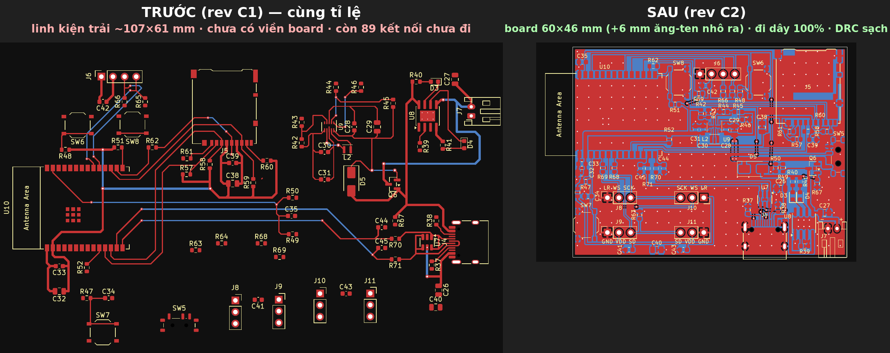
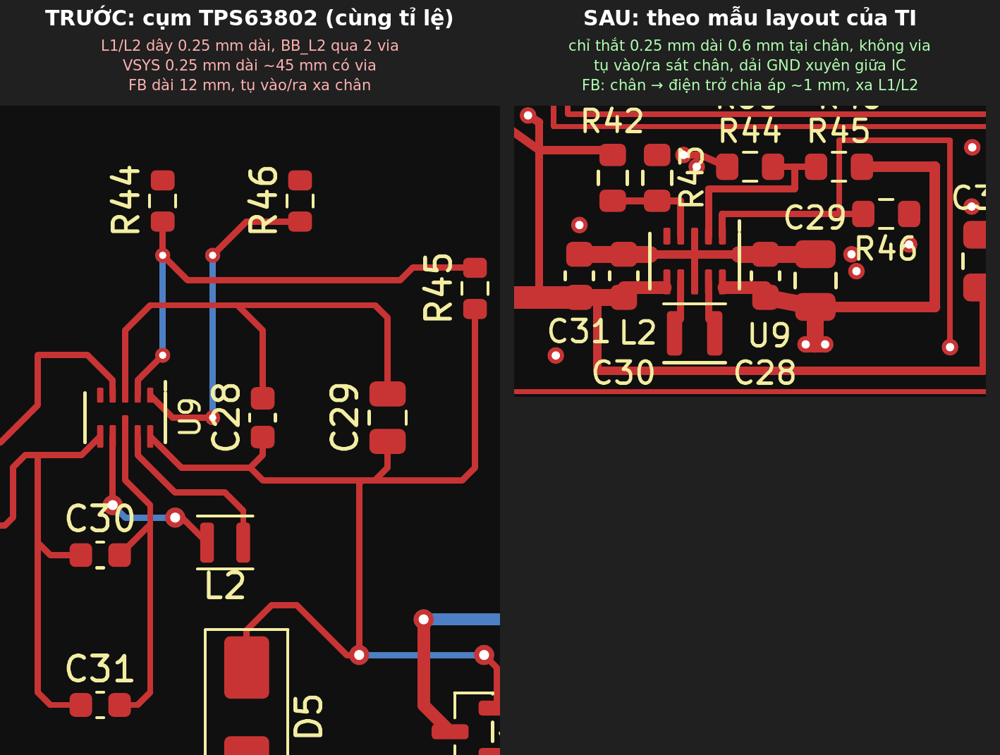

# ESP32-C6 audio recorder – rev C2 (layout PCB mới)

Rev C2 **giữ nguyên schematic rev C1**: file `.kicad_sch` giống hệt từng byte, netlist không đổi. Chỉ PCB và net class được làm lại.
Bản gốc vẫn nằm nguyên ở [`../esp32c6_recorder_revC1_goc/`](../esp32c6_recorder_revC1_goc/).

## Mở file

1. Mở `esp32c6_recorder.kicad_pro` bằng KiCad 10.
2. Mở PCB và bấm **B** để đổ lại vùng đồng GND.
3. Chọn *Inspect → Design Rules Checker*, tick *Test for parity between PCB and schematic*, rồi bấm *Run DRC*.

## Số liệu trước / sau

| | rev C1 (bản gốc) | rev C2 |
|---|---|---|
| Kích thước | linh kiện trải ~107 × 61 mm, chưa có viền board | **60 × 46 mm**, ăng-ten chìa ra ngoài thêm 6 mm |
| Kết nối chưa đi dây | 89 | **0** |
| Dây ở lớp dưới | 283 mm (26 % tổng chiều dài) | **41 mm (4 %)** ở 9 chỗ nhảy lớp ngắn |
| Vùng đồng GND | không có | GND cả 2 lớp, 204 via khâu |
| L1/L2 của TPS63802 | ~7 mm, BB_L2 qua 2 via | 1.4 mm, không via |
| Nút FB | 12 mm | 3.7 mm |
| VSYS (đầu vào bộ nguồn) | rộng 0.25 mm, dài 45 mm, 2 via | rộng 0.6–0.8 mm |
| USB D+ / D− (từ cổng đến chip) | 89 / 96 mm, ~70 mm chạy ở lớp dưới | 43 / 43 mm, gần như toàn bộ ở lớp trên |

## Đã sửa gì và vì sao

### 1. Cụm TPS63802: làm theo layout mẫu của TI

- **Tụ:** tụ vào (C28, C29) và tụ ra (C30, C31) đặt sát chân. GND của chúng nối bằng dải đồng chạy xuyên giữa IC, đúng như layout mẫu trong datasheet TI (SLVSEU9D). Vòng dòng xung (tụ → IC → GND → tụ) giờ chỉ dài vài mm.
- **L1, L2:** đi thẳng từ chân xuống pad cuộn cảm, không via. Dây chỉ thắt còn 0.25 mm trên đoạn 0.6 mm nằm giữa mép pad IC và mép pad cuộn cảm.
- **FB:** R42/R43 (chia áp) đặt sát chân FB, ở phía đối diện L1/L2. Dây từ chân FB đến điện trở dài khoảng 1 mm.
- **Lớp dưới:** ngay dưới IC, cuộn cảm và các tụ là GND liền, không có dây nào.

### 2. Nguồn

- **+3V3:** trục chính rộng 0.8 mm, đi từ đầu ra bộ nguồn tới chân 3V3 (pin 2) của module. Tại chân có C32 (22 µF) và C33 (100 nF).
- **VSYS:** rộng 0.6–0.8 mm, bản cũ chỉ 0.25 mm. Cùng chiều dài thì điện trở dây giảm 2.4–3.2 lần.
- **Công tắc SW5:** chỉ đóng ngắt chân EN (BB_EN), không mang dòng tải. Phần này không đổi so với schematic, chỉ ghi lại cho dễ hiểu.
- **U8 (TP4056):** via tản nhiệt dưới pad đổi lỗ từ 0.2 mm lên 0.3 mm (pad 0.6 mm). Lý do: board 2 lớp của JLCPCB yêu cầu lỗ tối thiểu 0.3 mm, và rule của chính project này cũng là ≥ 0.3 mm. Vì sửa footprint nên KiCad sẽ báo U8 khác thư viện. Đó là chủ ý.
- **Pad tản nhiệt:** pad tản nhiệt của U10, U8 và chân GND của J4 nối đặc vào vùng GND, không dùng thermal relief.

### 3. USB

- R70/R71 (22 Ω) dời về sát ESP32. U7 (USBLC6-2SC6) đặt sát cổng USB-C.
- D+/D− chạy ở lớp trên, phía dưới là GND liền. ESP32-C6 chỉ chạy USB Full Speed (12 Mbit/s) nên không cần đi cặp vi sai 90 Ω.
- Via đều 0.6/0.3 mm. Riêng 1 via USB_DM kẹt giữa 2 dây D+ nên chỉ vừa 0.5/0.3 mm.

### 4. Ăng-ten và chống nhiễu

- Module ESP32-C6-WROOM-1 đặt sát mép trái. Toàn bộ vùng ăng-ten (6 mm) nằm ngoài board, đúng cách Espressif khuyên.
- Phần board cạnh ăng-ten là GND liền cả 2 lớp, khâu via bước 2.5 mm.
- Hai mic INMP441 ở nửa dưới board. Khoảng cách tới cuộn cảm L2: MIC2 ~17 mm, MIC1 ~27 mm.
- Không có via nào trên nút chuyển mạch. FB nằm ở phía đối diện cuộn cảm.

### 5. Net class (trong `.kicad_pro`)

| Net class | rev C1 | rev C2 | Lý do |
|---|---|---|---|
| Default | 0.25 mm | 0.2 mm | Lách được giữa các chân bước 0.5 mm |
| POWER_1A (VBUS, VBAT, VSYS, GND) | 0.5 mm, via 0.8/0.4 | 0.6 mm, via 0.6/0.3 | Dây nguồn rộng hơn, via gọn hơn |
| SW_NODE (BB_L1, BB_L2) | 0.8 mm | 0.25 mm | Chân L1/L2 của TPS63802 chỉ rộng 0.25 mm và cách nhau 0.5 mm, nên dây 0.8 mm không thoát ra khỏi chân được. Đoạn 0.25 mm chỉ dài 0.6 mm (xem phần Hỏi đáp). |
| USB | via 0.6/0.3 | via 0.5/0.3 | Cho via USB_DM kẹt giữa 2 dây D+ |
| PWR_3V3 (mới, net `+3V3`) | thuộc POWER_1A (0.5 mm) | mặc định 0.4 mm | Trục chính đi tay 0.8 mm, nhánh nhỏ 0.3–0.4 mm |

Rule chung của board (*Board Setup → Constraints*) giữ nguyên như rev C1: dây ≥ 0.2 mm, lỗ ≥ 0.3 mm, via ≥ 0.5 mm, đồng cách mép board 0.5 mm.

## Kết quả DRC (KiCad 10.0.8, có kiểm tra khớp schematic)

- **0 lỗi:** không vi phạm khoảng cách, không còn pad nào chưa nối, PCB khớp schematic.
- **79 cảnh báo (warning), đều biết nguyên nhân:**
  - 68 `lib_footprint_issues`: máy dựng layout không cài thư viện footprint chuẩn của KiCad nên không so được. Trên máy có thư viện chuẩn, dự kiến các cảnh báo này sẽ hết, chỉ U8 chắc chắn còn báo khác thư viện (xem mục 2).
  - 11 `silk_edge_clearance`: silkscreen của J4, J7 và U10 chạm mép board, vì các linh kiện này cố ý chìa ra ngoài mép. Nhà mạch tự cắt phần chữ thừa.

## Hỏi đáp

### Dây 0.25 mm ở TPS63802 có gây cháy không?

**Chạy bình thường thì không cháy.**

- **Dòng thực tế:** dòng lớn nhất qua L1/L2 khoảng 0.9–1 A đỉnh. Đây là lúc pin còn 2.8–3.0 V, tải 600 mA và IC phải tăng áp.
- **Khả năng chịu dòng:** theo IPC-2221, dây 0.25 mm đồng 1 oz ở lớp ngoài chịu khoảng 0.9 A nếu cho nóng thêm 10 °C, khoảng 1.2 A nếu cho nóng thêm 20 °C. Mức nóng đó áp dụng cho dây dài. Đoạn ngắn 0.6 mm thì nhiệt tản ngay sang pad nên gần như không nóng.
- **Khi chập tải:** IC giới hạn dòng đỉnh qua cuộn cảm ở khoảng 3.8–5.75 A, tùy chế độ buck hay boost. Lúc đó dây 0.25 mm dài vài cm sẽ nóng như cầu chì, còn đoạn 0.6 mm thì không sao.

**Vấn đề thật của bản cũ là nhiễu và sụt áp, không phải cháy:**

- **Điện cảm:** dây mảnh, dài, lại thêm via, tạo điện cảm đúng ở các vòng dòng xung. Hậu quả là gai áp ở nút chuyển mạch, nhiễu phát xạ, và tạp âm lọt vào đường thu âm.
- **Sụt áp:** VSYS 0.25 mm × 45 mm có điện trở khoảng 0.09 Ω. Ở 0.8 A dây này sụt khoảng 70 mV và tỏa khoảng 56 mW. Không nguy hiểm, chỉ phí điện.
- **FB:** dây FB dài 12 mm như một ăng-ten nhỏ, bắt nhiễu từ cuộn cảm vào vòng ổn áp.

**Cách làm đúng, cũng là cách TI làm:** sát chân thì thắt dây bằng bề rộng pad, ra khỏi chân là mở rộng ngay. Tụ đặt sát chân để vòng dòng xung nhỏ nhất. Không cần cố đi dây 0.5 mm tại chân.

### Gộp các module có thừa tụ không? Tụ phóng cùng lúc có làm cháy linh kiện không?

**Không thừa tụ, và không cháy.**

| Đường nguồn | Tụ | Tổng (danh định) | Năng lượng ½CV² |
|---|---|---|---|
| +3V3 | C30, C31, C32 (22 µF), C38 (10 µF), 3 × 100 nF | 76 µF | 0.42 mJ |
| VSYS | C28 (10 µF), C29 (22 µF) | 32 µF | 0.28 mJ (pin 4.2 V) |
| MIC_VDD | C40 (10 µF), 2 × 100 nF | 10 µF | 0.06 mJ |
| VBUS | C26 (10 µF) | 10 µF | 0.13 mJ |
| VBAT | C27 (10 µF) | 10 µF | 0.09 mJ |
| **Cả board** | | **~140 µF** | **~1 mJ** |

- **Vì sao không thừa:** tụ gốm mất bớt điện dung khi có điện áp DC, nên 76 µF trên +3V3 thực tế chỉ còn khoảng 40 µF. TI yêu cầu đầu ra có tối thiểu 7 µF thực và ghi rõ "There is no upper limit for the output capacitance value". Lúc khởi động, IC tăng dòng từ từ trong 224 µs (soft-start), nên số tụ này không gây quá dòng.
- **Vì sao không cháy:** các tụ mắc song song trên cùng một đường nguồn có cùng điện áp, nên không phóng vào nhau. Khi tắt nguồn, chúng chỉ xả vào chính mạch, đó là hoạt động bình thường. Tổng năng lượng khoảng 1 mJ, bằng năng lượng một con LED 0603 tiêu thụ trong 25 ms. Một viên pin 1000 mAh chứa khoảng 13 000 J, gấp hơn 10 triệu lần.

**Thứ thật sự có thể làm cháy board là pin, không phải tụ:**

- **Cắm ngược cực pin:** TP4056 và các đường nguồn sẽ hỏng ngay. Cực của đầu JST PH trên pin bán sẵn không thống nhất giữa các hãng, nên phải đo bằng đồng hồ trước khi cắm. Trên board, J7 chân 1 là GND, chân 2 là VBAT, có in dấu + / − ở silkscreen.
- **Pin không có mạch bảo vệ (PCM):** nếu chập mạch thì không có gì chặn dòng. Schematic đã ghi "LiPo 1S (có PCM)", nhớ mua đúng loại có PCM.
- **Tụ gốm bị nứt:** board bị cong có thể làm tụ gốm nứt và chập thành ngắn mạch. Trên đường pin, ngắn mạch kiểu này nguy hiểm. Đừng bẻ cong board, đừng siết vít lệch.

**Hai lưu ý nhỏ, không gây cháy:**

- **Cắm USB khi pin cạn:** VBUS phải nạp C26 cộng với các tụ VSYS (qua D5), tổng khoảng 42 µF, vượt mức 10 µF của chuẩn USB. Hậu quả chỉ là một xung dòng ngắn, cổng USB của máy tính tự giới hạn được.
- **Cắm nóng USB:** do điện cảm của cáp, tụ gốm có thể làm điện áp vọt lên vài volt trong vài µs. Nhiều tụ hơn thì vọt ít hơn, không phải nhiều hơn. Giới hạn chịu áp: TPS63802 tối đa 6 V ở VIN; TP4056 khoảng 8 V (cần đối chiếu datasheet). Muốn chắc ăn thì thêm một diode TVS 5 V (ví dụ SMF5.0A) trên VBUS, cạnh cổng USB. Rủi ro này là suy luận, chưa đo thực tế.

## Khuyến nghị (chưa sửa, để tự quyết)

1. **Chạy PWM cố định khi ghi âm.**
   - Hiện tại R44 (0 Ω) kéo MODE xuống GND, tức IC chạy chế độ tiết kiệm (PFM). Ở tải nhẹ, tần số đóng cắt của PFM thay đổi và có thể rơi vào dải âm thanh. Mic đã có bộ lọc R64/C40 nên đây là cải thiện thêm, không bắt buộc.
   - Cách 1: hàn R45 và bỏ R44 để chạy PWM cố định (1.4–2.1 MHz, xa dải âm thanh). Đổi lại, ở tải nhẹ IC tốn điện hơn, cỡ mA thay vì µA.
   - Cách 2: nối MODE vào một GPIO để firmware tự chuyển: PWM khi ghi âm, PFM khi chờ. Cách này phải sửa schematic.
2. **Thêm TVS trên VBUS**, như ở phần trên. Phải sửa schematic.
3. **Lỗ bắt vít:** chưa thêm vì chưa biết vỏ hộp.

## Phải tự kiểm tra trước khi đặt mạch

1. **Module INMP441 (J8/J9, J10/J11):**
   - Layout giả định 2 hàng chân cách nhau 7.62 mm. Phải đo trên module thật.
   - Mic là loại lỗ âm ở mặt dưới (bottom port), lỗ xuyên qua mạch module. Khi hàn header vào module, phải để mặt có lỗ quay ra ngoài, không úp vào board.
   - MIC2 xoay 180° so với MIC1. Thứ tự chân đã in trên silkscreen.
2. **L2:** mã mua là Murata DFE201612E-R47M, còn footprint đang gán là DFE201610P. Hai loại cùng thân 2.0 × 1.6 mm, nhưng phải so land pattern trong datasheet Murata.
3. **Footprint TPS63802 và ESP32-C6-WROOM-1 (tự vẽ):** in `in_1_1_mat_tren.pdf` ở tỉ lệ 100% (tắt *Fit to page*). Đo cạnh board trên giấy phải đúng 60.0 mm. Sau đó đặt linh kiện thật lên để so.
4. **Linh kiện chìa ra mép board:** ăng-ten, USB-C, công tắc và đầu pin chìa ra ngoài mép, khe thẻ nằm sát mép. Khi đặt JLCPCB lắp ráp SMT, thường phải thêm viền công nghệ (edge rails). Bước kiểm DFM của JLC sẽ báo nếu cần.
5. **Pin và công tắc:**
   - Đo cực J7 trước khi cắm pin.
   - Kiểm SW5 gạt về phía nào là ON: chân 1 là VSYS, chân 3 là GND, chân 2 (giữa) là EN.
6. **OLED (J6):**
   - Thứ tự chân trên board từ trái sang phải là **GND, VCC (3V3), SCL, SDA**. Nhiều module bán ngoài có thứ tự VCC, GND, ... Cắm loại đó vào là ngược nguồn.
   - Nếu cắm module OLED thẳng vào J6, màn hình sẽ nằm đè lên board về phía dưới và che nút SW6, SW8. Nếu cần bấm nút khi OLED đang cắm, nối OLED bằng dây, hoặc xoay J6 để màn hình chìa ra ngoài mép trên.
7. **DRC:** chạy DRC trên máy có thư viện chuẩn của KiCad, và xem lại các thay đổi net class ở trên.
8. **Tên linh kiện bị ẩn:** R64 (góc dưới trái, cạnh C34) và R65 (hàng trên, giữa R66 và R48) không còn chỗ in tên trên silkscreen nên tên bị ẩn. Xem vị trí trong file PCB hoặc trên bản in F.Fab.
9. **Via USB_DM 0.5/0.3 mm:** bằng đúng mức tối thiểu cho board 2 lớp mà nhiều nguồn ghi cho JLCPCB, nhưng các nguồn này không thống nhất. Khi up Gerber, xem kết quả kiểm DFM của JLC.
10. **ERC:** schematic không đổi, nhưng vẫn phải chạy ERC trong KiCad như README rev C1 đã dặn.
11. **LED 0603:** dấu cực tính trên LED mỗi hãng một kiểu, xem datasheet trước khi hàn.

## Firmware cần chỉnh (giữ nguyên từ rev C)

- **ESP-IDF:** chạy `idf.py menuconfig` → *Component config → ESP System Settings → Channel for console output* = **USB Serial/JTAG**.
- **Arduino:** *Tools* → **USB CDC On Boot: Enabled**.
- **Khi mất cổng USB:** nếu firmware treo, ngủ sâu, hoặc lấy IO12/IO13 làm GPIO thì cổng USB sẽ mất. Cách nạp lại: **giữ BOOT, bấm RESET, thả BOOT** để chip vào ROM download, cổng USB sẽ hiện lại.

## File trong thư mục

| File | Nội dung |
|---|---|
| `esp32c6_recorder.kicad_pcb` | PCB rev C2 (60 × 46 mm, 2 lớp) |
| `esp32c6_recorder.kicad_sch` | Schematic, giống hệt rev C1 |
| `esp32c6_recorder.kicad_pro` | Project, đã sửa net class |
| `bom.csv` | BOM, giống rev C1 (có mã LCSC) |
| `lib/` | Symbol và footprint riêng (ESP32-C6-WROOM-1, TPS63802), giống rev C1 |
| `in_1_1_mat_tren.pdf` | Bản in 1:1 mặt trên (pad, viền linh kiện, silkscreen), dùng để so footprint với linh kiện thật |
| `hinh/` | Ảnh so sánh trước/sau, lớp trên, lớp dưới |
